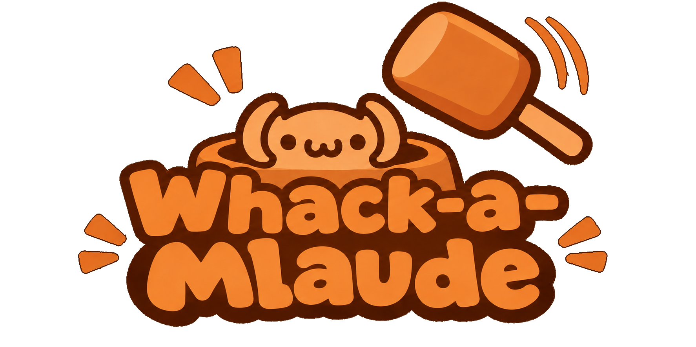

# Whack-a-Mlaude

*Great developers use the tools they are building while they are building them. Just as Git was built using itself for version control, this minigame was vibecoded while being played!*



Use this minigame to kill time, looking ultra-focused on your terminal, while Claude does the hard work!

## Install

In a Claude Code session:

```
/plugin install whack-a-mlaude --marketplace TeogopK/Whack-a-Mlaude
```

Or from a shell:

```
claude plugin install whack-a-mlaude --marketplace TeogopK/Whack-a-Mlaude
```

Or just ask Claude to do it...

## Play

While Claude works, a game area appears above the prompt. It looks like agent output: it shows your session's real prompts, tool calls and replies. Now and then a character slowly turns into a little mole, `(•ω•)`, popping out of the dirt. Hover over it to whack it. When Claude finishes, the game goes away and you get a short end-of-round summary.

- Hover over the mole to whack it.
- Click the game area to focus it. Press `p` to pause, and `h` if the boss is looking.
- Run `/whack help` to see all the options you can configure.

## Footnotes

Before installing random stuff verify that the code is not malicious with your own tool!
Do not waste too many trees just to play the minigame!